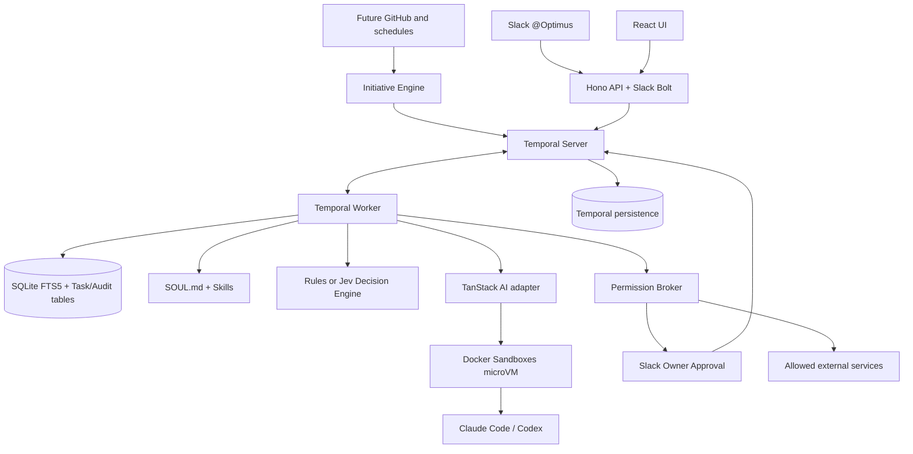

# Optimus Architecture

**Boundaries:** Temporal owns mission lifecycle; TanStack AI owns harness invocation; sandbox owns untrusted execution; host broker owns privileged action authorization; SQLite owns long-lived agent state; Slack/UI are channels, not the agent's brain.

**Temporal history ≠ streamed LLM tokens:** save streaming chunks to an external event log, store artifact references and compact outputs in Temporal history.

**Workflow `taskWorkflow`**:

1. prepareAction (mock or sandboxed harness Activity)
2. requestApproval (Slack optional, stored in SQLite)
3. wait for owner decision (Signal, up to 7 days)
4. verify approval and policy outside the workflow
5. dry-run completion; real external action to be implemented later

**Long-term memory:** keep a small stable SOUL/profile in prompts; retrieve a small number of relevant SQLite FTS5 records per run; never inject unbounded `MEMORY.md`.

## Verified prototype flow

The authenticated API stores a task and starts its Temporal workflow. Activities prepare a simulated proposal and save an approval tied to a canonical SHA-256 payload. The proposal is persisted for dashboard review before an optional Slack notification. The workflow ignores signals for other approvals and records the first matching decision. The host broker requires the persisted approved decision, matching task and payload hash, a current allowlist entry, and an unpaused agent. Completion is simulated.

Cancellation and activity failure update SQLite through a non-cancellable status Activity. The integration test restarts the worker and disk-backed Temporal server while an approval is pending, then resumes the same mission after approval. SQLite files remain on disk. Optional Slack notification failure does not close the mission.

## Not yet durable

The API's SQLite write and Temporal start are separate operations. External-event deduplication is persisted before workflow startup and has no outbox recovery yet. Real artifact extraction, sandbox execution cancellation, real action idempotency, event replay and workflow versioning remain future work.
